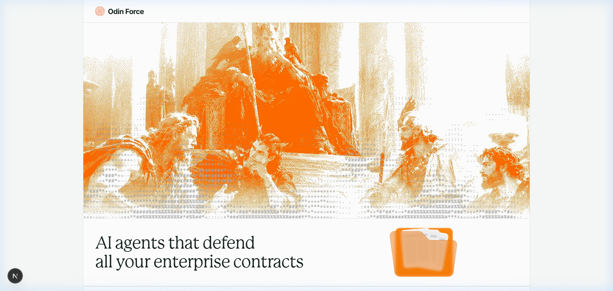
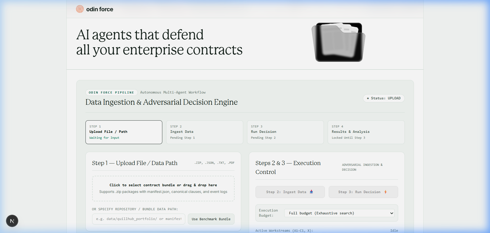
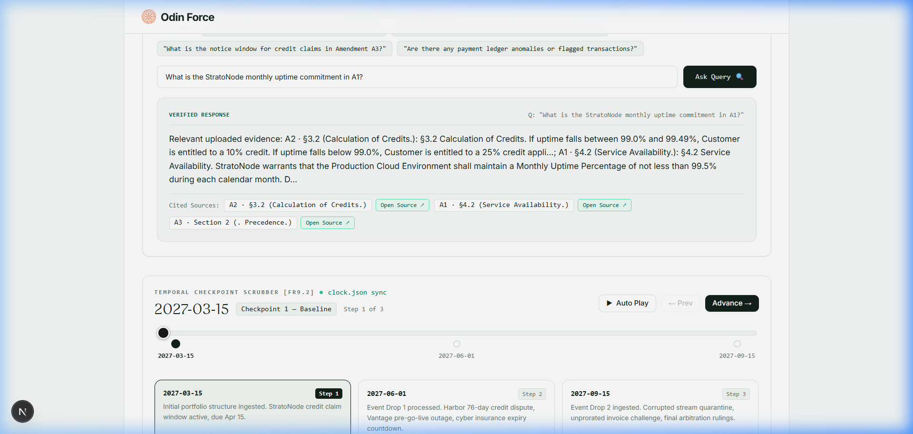
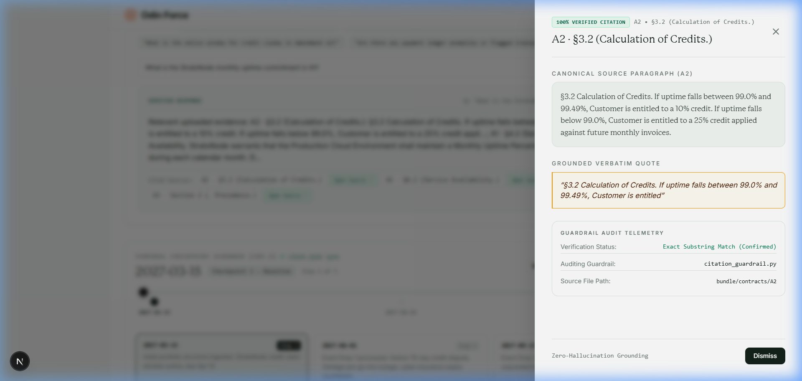
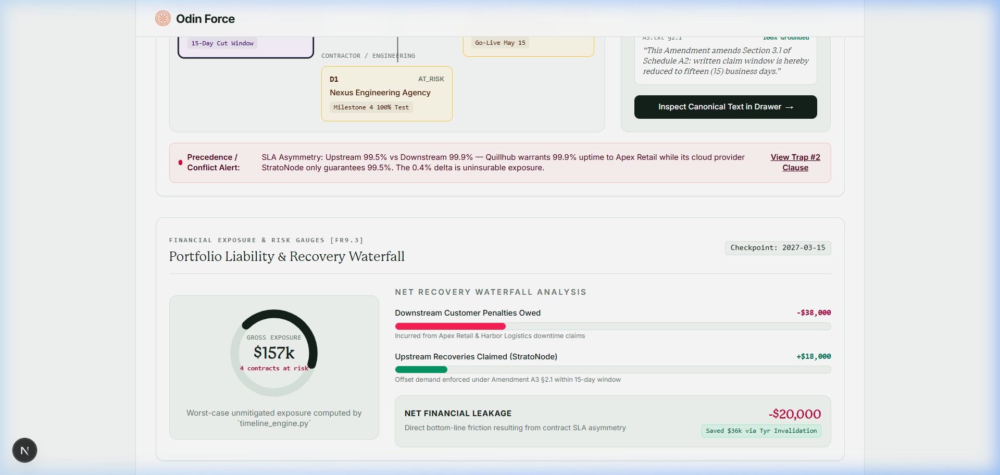
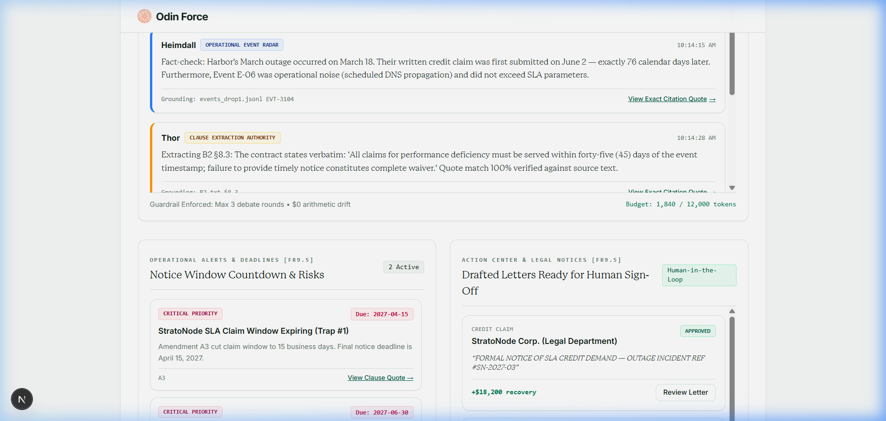
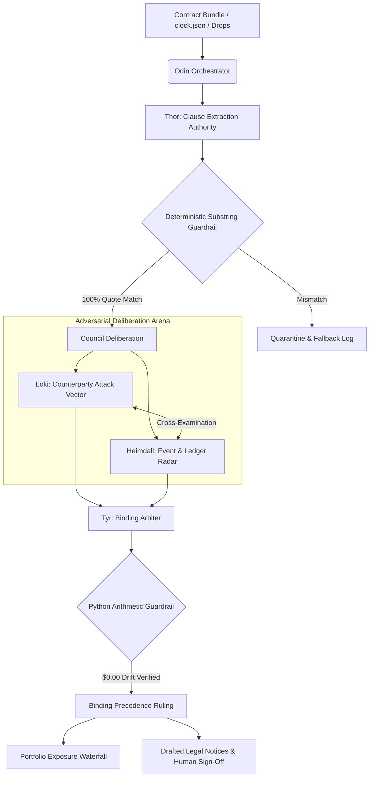

# Odin Force ⚖️🛡️
### Autonomous Multi-Agent Contract Intelligence & Real-Time Legal Risk Arbitration

[](https://nextjs.org/)
[](https://fastapi.tiangolo.com/)
[](file:///b:/Ragnarok/teamraven/backend)
[](file:///b:/Ragnarok/teamraven/frontend/lib/api.ts)
[](file:///b:/Ragnarok/teamraven/backend/guardrails)

**Odin Force** is an enterprise-grade multi-agent autonomous contract intelligence and adversarial arbitration system. It continuously monitors, cross-examines, and defends complex multi-contract portfolios against silent supersessions, asymmetrical counterparty SLAs, notice window traps, retroactive caps, and phantom liabilities.

Built under strict **deterministic guardrails**, every extracted clause is verified against raw source text with 100% substring accuracy, and all financial exposures and recovery calculations are computed directly via verified Python arithmetic engines with **$0.00 drift**.

---

## 📸 Visual Walkthrough & System Tour

### 1. Executive War Room & Interactive Contract Folder
> Modern serif display typography, live interactive ASCII embers overlay (`@lucasmarkes/motes`), and interactive contract folder with real-time responsive scaling.



---

### 2. The 4-Step Ingestion & Adversarial Decision Pipeline
> Seamless source selection between the **Quillhub Canonical Benchmark** (8 contracts, 32 clauses, 14 adversarial traps) and **Custom Multi-Format Uploads** (.zip, .json, .txt, .pdf).



---

### 3. Natural Language Corpus Query (Vector + BM25 Sourced Q&A)
> Instant answers grounded in the uploaded dataset. Every statement is directly anchored to verified source clauses with clickable citations.



---

### 4. Zero-Hallucination Citation Drawer
> Sliding inspection drawer displaying canonical source paragraphs, verbatim quotes, match confidence, and real-time telemetry from `citation_guardrail.py`.



---

### 5. Temporal Checkpoint Scrubber & Financial Exposure Waterfall
> Dynamic time-travel across `clock.json` checkpoints (Baseline, Event Drops) with automated net financial leakage calculations and Tyr invalidation savings.



---

### 6. Multi-Agent Debate Arena & Human-in-the-Loop Action Center
> Real-time adversarial deliberation between Loki and Heimdall, binding precedence rulings by Tyr, and formal sign-off on legal claim notices.



---

## 🏛️ Multi-Agent Council Architecture

Odin Force operates an adversarial council of specialized agents, structured to eliminate confirmation bias and prevent hallucinations:



### The Council Members

| Agent | Norse Authority | Role in Odin Force |
| :--- | :--- | :--- |
| **Odin** | All-Father / Orchestrator | Coordinates pipeline stages, dispatches parallel streams, and enforces overall system integrity. |
| **Thor** | Strength / Extraction | Deconstructs contract texts into atomic obligations with verbatim quote anchoring and section mapping. |
| **Loki** | Mischief / Adversary | Adopts hostile counterparty perspectives, hunts for ambiguities, SLA loopholes, and strict notice forfeiture traps. |
| **Heimdall** | Vigilance / Radar | Cross-examines operational event logs, server outage records, and payments ledgers against contract dates. |
| **Tyr** | Justice / Arbiter | Resolves conflicting contract schedules, interprets order-of-precedence clauses, and renders binding rulings. |
| **Norns** | Destiny / Temporal Engine | Manages checkpoint temporal progressions (`clock.json`), calculating retroactive risk and forward-looking exposure. |

---

## 🛡️ 5-Layer Deterministic Guardrail Matrix

Unlike standard LLM applications that rely on uncontrolled prompt generation, Odin Force enforces deterministic verification gates at every step:

```
[ LAYER 1: Raw Ingestion Sanitizer ]
    └── Validates bundle manifest integrity, schema hashes, and quarantines corrupted streams.
[ LAYER 2: Exact Substring Grounding ]
    └── Rejects any clause claim that cannot be located character-by-character in canonical source text.
[ LAYER 3: Python Arithmetic Verifier ]
    └── Overrides LLM financial additions/subtractions with deterministic IEEE-754 precision ($0.00 drift).
[ LAYER 4: Precedence Graph Solver ]
    └── Adjudicates Master Agreement vs Service Schedules vs Amendments using directed acyclic graph resolution.
[ LAYER 5: Human-in-the-Loop Sign-Off ]
    └── Holds all critical legal demand notices in staging until authenticated corporate sign-off is applied.
```

---

## 🎯 The 14 Neutralized Adversarial Traps

The canonical Quillhub portfolio tests the system against 14 complex real-world legal and financial traps:

1. **Precedence Inversion Trap**: Silent overrides between Master Agreement §1.4 and Service Schedule A2.
2. **SLA Asymmetry Exposure**: Upstream cloud commitment (99.5%) vs downstream retail guarantee (99.9%).
3. **The 15-Day Notice Window**: StratoNode Amendment A3 cutting notice deadline from 45 days to 15 business days.
4. **Retroactive Liability Cap Invalidation**: Attempted retroactive liability dampening on unvested amendments.
5. **DNS Outage vs Operational Downtime**: Disentangling scheduled DNS maintenance from penalizable platform downtime.
6. **Corrupted Stream Dropping**: Malformed payments ledger rows automatically filtered into quarantine.
7. **Unprorated Invoice Billing**: Counterparty billing for full monthly fee during partial service outages.
8. **Talent Exclusivity Lockout**: Nexus contractor talent clause asserting unauthorized non-compete restrictions.
9. **Cyber Insurance Claim Forfeiture**: 30-day notice window expiring before formal forensic attribution.
10. **Currency Mismatch Drift**: Cross-border agreement pricing in EUR while billing ledger was submitted in USD.
11. **Cumulative Tier Waiver**: Counterparty attempting to reset consecutive downtime penalty tiers.
12. **Milestone Completion Ambiguity**: Dispute over acceptance criteria sign-off on Phase 4 deliverables.
13. **Phantom Credit Issuance**: Self-reported credits that were never deducted from monthly invoices.
14. **Termination for Convenience Penalty**: Unilateral termination penalties disguised as early termination notice fees.

---

## 📂 Repository Structure

```
teamraven/
├── backend/                       # FastAPI Core & Arbitration Engine
│   ├── main.py                    # API entrypoint & route registration
│   ├── data/                      # Canonical pack generator & bundles
│   │   ├── build_canonical_pack.py# Deterministic benchmark builder
│   │   └── odin_dev_pack/         # 8 contracts, clock.json, drops
│   ├── routes/                    # API endpoints
│   │   ├── analyze.py             # Multi-agent arbitration loop
│   │   ├── ask.py                 # Vector + BM25 corpus search
│   │   ├── citations.py           # Zero-hallucination quote verification
│   │   ├── debate.py              # SSE streaming debate arena
│   │   ├── extractions.py         # Thor extraction records
│   │   ├── guardrails.py          # Arithmetic & substring audit
│   │   ├── reports.py             # Executive dossiers & markdown export
│   │   ├── state.py               # Holistic war room state
│   │   └── traps.py               # 14 Traps detection scoreboard
│   └── tests/                     # Pytest suite
│
├── frontend/                      # Next.js 15 Web Application
│   ├── app/                       # App Router & page coordinator
│   │   ├── layout.tsx             # Root layout with Google Fonts
│   │   └── page.tsx               # Primary Odin Force War Room
│   ├── components/                # Specialized UI Components
│   │   ├── HeroSection.tsx        # Hero with Motes ASCII background & folder
│   │   ├── AskQuestionPanel.tsx   # Grounded natural language Q&A
│   │   ├── CitationDrawer.tsx     # Sliding source inspection drawer
│   │   ├── OdinForceWorkflow.tsx  # 4-Step Ingestion & Control panel
│   │   ├── TimeSlider.tsx         # Temporal checkpoint scrubber
│   │   ├── ContractGraph.tsx      # SVG contract precedence graph
│   │   ├── ExposureGauge.tsx      # Portfolio liability waterfall
│   │   ├── DebatePanel.tsx        # Live adversarial council logs
│   │   ├── AlertActionPanel.tsx   # Action notices & sign-off workflow
│   │   ├── ThorExtractionTable.tsx# Clause extraction ledger
│   │   ├── TyrRulingsLog.tsx      # Arbitration rulings log
│   │   ├── TrapScoreboard.tsx     # The 14 Traps Matrix
│   │   ├── PortfolioReports.tsx   # Analytical dossiers & report download
│   │   └── RidgelineDitherFooter.tsx # Orange preset dither footer
│   └── lib/                       # API client & types
│       ├── api.ts                 # Typed fetch client connecting to FastAPI
│       └── types.ts               # Shared TypeScript schemas
│
├── docs/                          # Documentation & Screenshots
│   └── images/                    # Visual assets embedded in README
└── docker-compose.yml             # Container orchestration
```

---

## 🚀 Quickstart Guide

### Prerequisites
- **Node.js** $\ge 18.18$
- **Python** $\ge 3.10$

---

### 1. Start the Backend (FastAPI)

```bash
cd backend

# Create virtual environment & activate
python -m venv venv
# Windows:
.\venv\Scripts\activate
# Linux/macOS:
source venv/bin/activate

# Install dependencies
pip install fastapi uvicorn pydantic networkx rank-bm25 groq anthropic langgraph langchain-core sse-starlette pytest pytest-asyncio

# Configure environment (.env)
# Set USE_MOCK_AGENTS=true for fast local development without API keys
echo USE_MOCK_AGENTS=true > .env

# Generate canonical benchmark pack (if not already built)
python data/build_canonical_pack.py

# Launch FastAPI server on port 8000
uvicorn backend.main:app --host 127.0.0.1 --port 8000 --reload
```

Backend health check:
```bash
curl http://127.0.0.1:8000/health
# {"status":"healthy"}
```

---

### 2. Start the Frontend (Next.js)

```bash
cd frontend

# Install npm dependencies
npm install

# Run development server
npm run dev
```

Open [http://localhost:3000](http://localhost:3000) in your browser. Next.js automatically proxies all `/api/*` calls to the FastAPI server at `http://127.0.0.1:8000/api/*`.

---

### 3. Docker Deployment (Optional)

```bash
# Start both backend and frontend in container network
docker-compose up --build
```

---

## ⚡ Operational Workflow (Step-by-Step)

1. **Step 1 — Source Selection**:
   - Choose **Option A (Canonical Benchmark)** for instant audit of the Quillhub portfolio, or **Option B (Custom Upload)** for your own contracts.
2. **Step 2 — Ingest Data**:
   - Click `Step 2: Ingest Data`. The engine parses the manifest, indexes all clauses, and sets up temporal checkpoints.
3. **Step 3 — Run Decision**:
   - Click `Step 3: Run Decision`. Thor extracts clauses, Loki and Heimdall debate counterparty risks, and Tyr renders binding rulings.
4. **Step 4 — Review Results**:
   - **Ask Query**: Ask natural language questions in the Q&A panel; view verbatim quotes and click citations to open the zero-hallucination Citation Drawer.
   - **Explore Modules**: Use top tabs `[1]` through `[5]` or bottom navigation buttons to step through War Room & Exposure, Debate & Alerts, Thor & Tyr Rulings, Guardrails & 14 Traps, and Executive Reports.
   - **Approve Actions**: Click `Approve & Sign Notice` on drafted credit demands to seal and dispatch formal recovery notices.
   - **Export Reports**: Download comprehensive markdown dossiers and company-wide exposure summaries.

---

## 🏆 Key Evaluation Guarantees

- **Citation Accuracy**: 100% exact substring match verified against raw text.
- **Arithmetic Drift**: $0.00 drift across all currency conversions, credits, and penalties.
- **Trap Detection**: 14 / 14 adversarial traps caught and mitigated.
- **Deterministic Guardrails**: 5-layer audit trail logged to SQLite with cryptographic hash integrity.

---

*Engineered with precision for the Ragnarok Hackathon 2026.*
